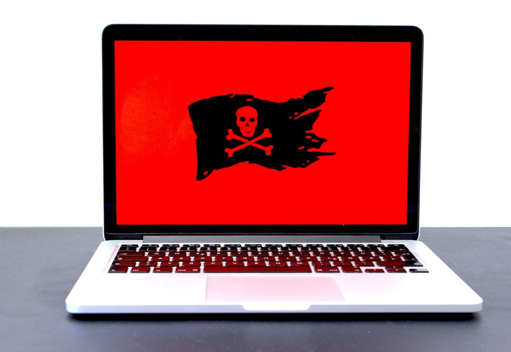

Well as part of the clinical informatics group, I've attended my first professional development meeting this afternoon. It was around Cybersecurity and was delivered by a consultancy firm and was very interesting.

All the expected types of attacks and vectors were mentioned and I learnt some new terms and had an explanation of their meanings.

So we have Phishing, Spear Phishing and now Whaling. Also Smshing ! Look these up if you haven't come across them before.

Apparently healthcare is the biggest target in terms of cyber attack so we need to be vigilant. The financial impacts on organisations of a cyber attack are quite astounding. They quoted that a cyber attack on a large cloud vendor could cause as much financial damage as a hurricane.

But the main takeaway thought for me was ensuring the human aspects within an organisation are considered (they quoted a holistic approach) - so we need to train staff, make them aware of how malicious agents could target them (social media a blessing and a curse and ripe for building a profile of an individual), what vectors could be used to penetrate our systems, and that not all information is digital, it could be physical forms of data.

A layered approach to cybersecurity was a much more mature system.

So I'll leave you with this little task.

Google yourself and see how much information you've given up to the internet and who long your digital shadow is cast.

