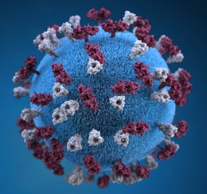
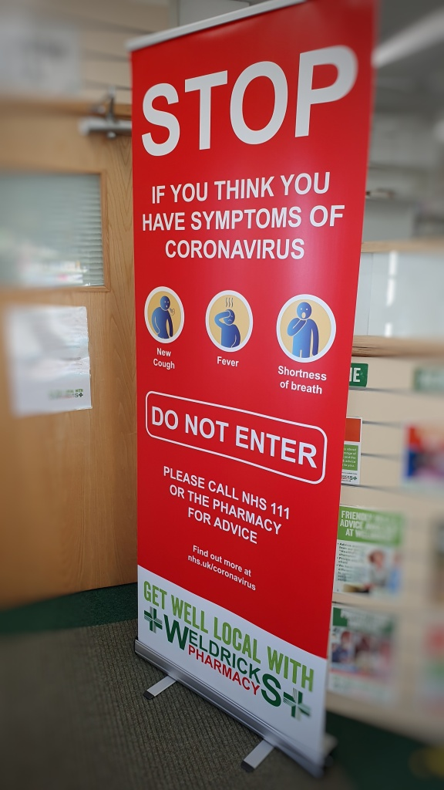

#### Update: March 2022

For some reason, this little blog remained in my drafts folder, and then got forgotten in the mists of time. I'm publishing it now as it is a nice reflective piece on my thoughts at the midpoint of the pandemic. I hope you find it interesting too.

[Severe Acute Respiratory Syndrome Coronavirus-2 (SARS-CoV-2)](https://www.who.int/emergencies/diseases/novel-coronavirus-2019) and the associated disease states termed Covid-19 have had an unprecedented impact on the world, and it is still on-going.

Ubiquitous Covid Graphic

I see myself as being fortunate as up until 2019, the few pandemics that we had experienced in my lifetime really didn't affect myself, my family, or my own day to day existence to any great extent.

SARS-CoV-2 certainly changed all of that, and I'm sure anyone reading this post, will agree that their lives have been changed too.

It was strange in the early days, as we (as a nation) were watching the [growth and the devastating effects of the virus](https://coronavirus.data.gov.uk/) as if immune or disconnected from that same world. Subsequently, it certainly brought it home to me, the levels to which we are connected on a global scale. How quickly a virus originating from a distant land can reach me and my colleagues, here in the glorious shire.

Good hygiene measures were reiterated from an early point, and many of us sang "Happy Birthday" (twice) in our heads whilst we washed our hands raw. Hand sanitizer and alcohol gels became the new "gold" (quickly followed by Pasta and Toilet Roll) as soon as the lockdown was announced.

The New Gold during Covid-19

A tsunami of prescriptions came, coinciding with an increase in demand for healthcare advice for patients as GP practices initiated closed-door policies to try and protect the capacity of primary care. Pharmacy teams endured weeks of pressure dealing with this double whammy - along with staff having to self-isolate or shield due to the government advice of the day. It was a stressful and worrying time for all the pharmacy profession, exposed as we were on the frontline.

Prescription Item Explosion

It also felt like a lot of organisations were "caught-out" (including our own government and NHS England) with the speed of transmission and the increasing death toll. The advice seemed to shift and change direction on a weekly basis. Often clarification had to be hard-fought for, and thankfully for pharmacy, there were numerous bodies who took up this challenge.

Special mention must go to the [Royal Pharmaceutical Society](https://www.rpharms.com/coronavirus) whose advocacy for pharmacy in this time was "unprecedented" - they opened some of the membership pages to non-members to provide support during the challenging times. 
Other pharmacy bodies also got adjustments in place to support Community Pharmacy.

- [Pharmaceutical Services Negotiating Committee (PSNC)](https://psnc.org.uk/the-healthcare-landscape/covid19/what-psnc-is-doing/)
  - advanced payment to support contractors, payment towards the cost of PPE, suspension of some contractual requirements and supporting pharmacy providing nationwide cover on the Bank Holidays during this period
- [General Pharmaceutical Council](https://www.pharmacyregulation.org/contact-us/coronavirus-latest-updates) [(GPhC)](https://www.pharmacyregulation.org/contact-us/coronavirus-latest-updates)
  - suspending pharmacy inspections, utilising the inspectorate team to support pharmacy, and sharing good practice, getting recently retired professionals back on the register in anticipation of demand and resolving the complex issue of the tranche of pre-registration pharmacists "stuck" in limbo due to cancelled assessments.
- [Association of Independent Multiple Pharmacies (AIMP)](https://www.aimp.co.uk/home)
  - Keeping pharmacy and its heroic frontline work for patients during the pandemic in the headlines.

There are many more bodies and individuals who have been instrumental during this challenging time, so apologies for any omissions.

The pharmacy profession had to 'pull out all the stops' to keep patients safe and well, along with protecting the pharmacy team during those manic weeks at the start of the lockdown. 
Social distancing became the norm in pharmacy, protective barriers, and Personal Protective Equipment (PPE) were commonplace. Protected time, where pharmacy introduced a closed-door policy for a few hours every day, was permitted by NHS England - it gave pharmacy teams the chance to catch-up on the workloads and clean down the pharmacy to ensure we reduced any potential transmission of the virus.

Now I've rambled on enough for this post - hence I've decided to break into parts. In my next sections, I hope to share some of the opportunities that have come along. Developments that people are saying will change our daily lives, and more importantly for me - pharmacy and healthcare. 
Plus, a mention of some of the fantastic work that pharmacy teams have achieved during this pandemic.

#### Afterword - I'm not Sure that I Am Going to Produce Any Further Updates on This. We Have All Been through This Together, and We All Have 'read the Book, Seen the Film, Worn the T-shirt' on This One
