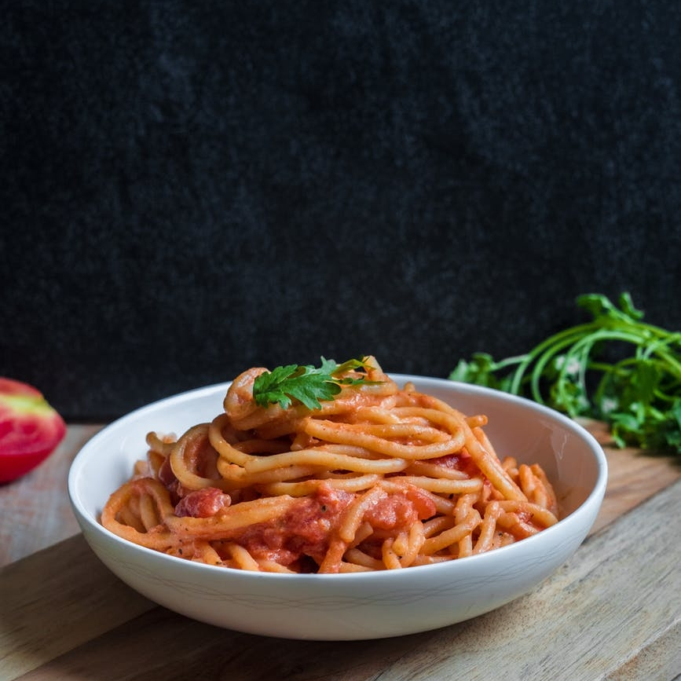

Think about what makes the ideal job

I noticed a tweet this evening from across the pond in the good old U S of A. Apparently there's a shortage of pharmacists there, although this appears to be contested by practising pharmacists. They cite poor working conditions as the reason for the vacancy issue in pharmacy.

> We don’t have a pharmacist shortage; we have a shortage of desirable pharmacy jobs.
>
> @irritatedrph

Does this sound familiar to pharmacists in the UK?

So, I started thinking about what makes a job a good job, no, what makes a job a **great** job. Well, here's my usual download of cognitive spaghetti - make of it what you will.

1. **Respect for me as a professional and autonomy to practice as such.**

So, I don't want to be micromanaged or my opinions on critical issues to be simply overridden. I'd like to be involved in the discussions that impact me, my practice, my team, and my patients. By involvement I don't mean the type of [consultation, as in the recent SI & RP regulation change](https://www.gov.uk/government/consultations/pharmacy-legislation-on-dispensing-errors-and-organisational-governance/outcome/rebalancing-medicines-legislation-and-pharmacy-regulation-programme-consultation-outcome) (where despite overwhelming numbers not agreeing to the change, it is going ahead despite the opposition) I mean a consultation where the conclusion isn't already decided.

2. **Work life balance**

So yes, I don't want to be working 42+ hours a week, with weekends included. This just contributes to burnout. If you include learning required for our roles not supported by the employer, then it's even more time spent doing the job. So, let's be radical, let us look at the core and supplementary hours of the pharmacies in which we work. Can we include a closed lunch period so the pharmacy team can take a step away from the bench and recharge? I don't mean closed to the public working either - genuine downtime during the manic day. Add into that some form of protected learning time as well if you really want to make the role attractive. If you ask me to attend learning outside of work hours, then make it the exception and give me the time back at some point in the near future.

_So that's the first two spaghetti strands for this evening, but I will continue in my next post._

---

Please feel free to comment and 'feed' into the next spaghetti strands.
