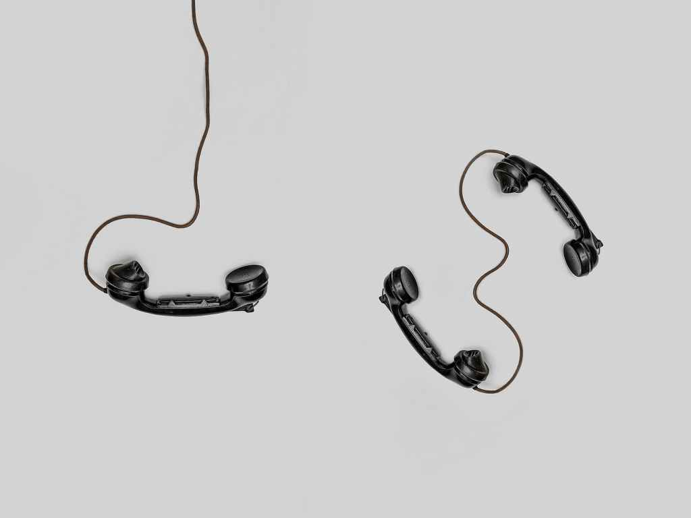
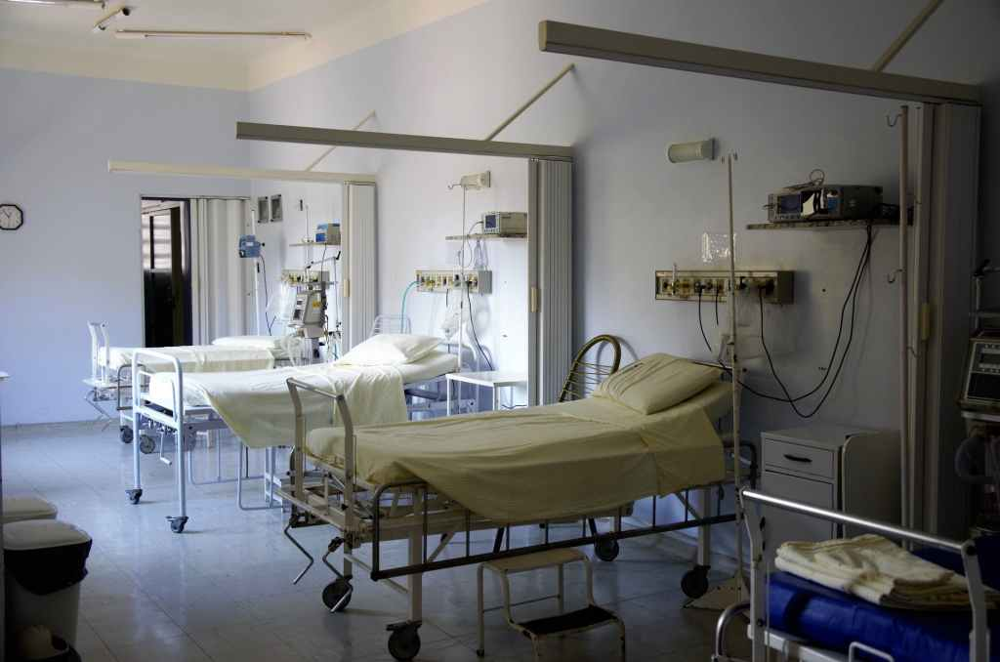

So I've recently had a little bit of a health problem. Not too serious (I'm hoping), just the wear and tear of age. Now I mostly manage my health without engaging my GP, as I've been lucky and most issues to-date have been minor and self-limiting. But this one had a rapid onset, no obvious cause in terms of trauma or injury and was persistent. So time to access my GP.

## Step 1 - Try and Get an Appointment

So locally I can only call on the day, at 8am, and attempt to grab a slot before they have gone. Tuesday I went to the surgery to see if there was any other way to try and get an appointment - nope. Wednesday was a half day training so appointments were limited - nope. Thursday morning my wife and I were on a mission, from 8am two mobiles and one landline rang the GPs until 8.15 when I struck gold. No GP appointment, but a physician assistant available that afternoon. I was lucky enough to be able to have the time off from work and get there easily.

## Step 2 - Attend Appointment

So the PA was great in that they checked the usual, ruled out the possibilities I had also ruled out, and took my vitals. But he was stumped too. So he took photos on my phone and uploaded them via AccuRx and popped them into my record. He would need to consult a colleague and would get back to me that afternoon.

## Step 3 - The Telephone Call

So at just after 3pm I had a call, and the surgery had decided to refer me to AMU at the local hospital to try and rule out a DVT. I didn't think it was, but hey, I don't know it all. So I had to travel to the local hospital and get there before 5pm*. I can, because I can afford a car and can easily get around.* I got there, parked up and paid the not unsubstantial parking fee.

## Step 4 - AMU

I got to AMU and because my GP had sent my details across i was booked in pretty quickly. It was very busy, and lots of ill people there - felt a bit of a fraud. Bloods and measurements were done (never felt the phlebotomist take the samples at all - she was awesome) and then some more waiting for the results from the labs. Eventually I was called in by a nurse ACP who went through the history, did a thorough exam, but like me was stumped as to the cause. I asked if a urate could be added to the bloods just in case, and they agreed. Back to the waiting room to still await the results from the labs. My wife works in biochemistry in another hospital and she was messaging me with their turnaround times and what tests I should be asking for...

## Step 5 - The Results

So eventually called back in by the awesome nurse ACP (he really was good), to be told my d-dimer was raised (but everything else was fine - no gout). This is a test they use to see if a patient has had a Deep Vein Thrombosis (DVT). So, there was a possibility that I might have had a DVT, but an ultrasound scan would be needed to confirm. The earliest appointment would be Sunday. Could I make that? Of course! As I said previously I have the transport the time and the money to do this. Others might not. But to cover me in the meantime he gave me a prescription for some anticoagulants. The hospital pharmacy was closed by now, so I needed to find an open pharmacy.

## Step 6 - Late Opening Pharmacy

So I needed to find a local pharmacy to get the prescription dispensed and start the medication that evening. Luckily I have a smartphone and data. I can use the NHS website https://www.nhs.uk/service-search/pharmacy/find-a-pharmacy to locate an open pharmacy and then drive there.

## Step 7 - Get Prescription Dispensed

So I located a late night pharmacy based in the local surgery. Finding the entrance was fun, but a quick call to them, and they gave me directions. The pharmacist was brilliant, they had the stock in and I paid my prescription fee for the 6 tablets I'd been given as a short course. Finally I could make my way home.

## Reflections

I know I'm in a really fortunate position. On the whole I'm healthy, have no long term medical conditions (confirmation pending), have familiarity with the health service and can support myself in getting to appointments and getting the right data and information. But all along this journey I was thinking about the various points where patients could fall 'between the cracks' and perhaps not be able to access the services as I did.

Imagine having multiple hospital appointments and not having transport.

Or not having English as your first language and trying to find the right point to access the care you need.

So I'm not moaning about any aspect of the treatment journey to-date. In fact I count myself as very lucky. But I will try and support patients who come into the pharmacy who might be meeting obstacles along their treatment pathway.

And yes I will post an outcome of my own treatment pathway.
