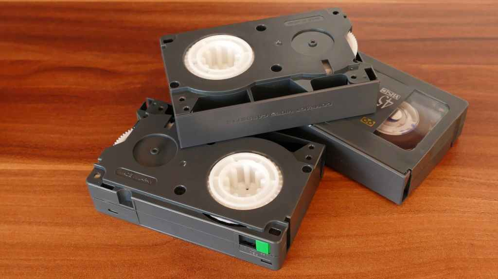

Given the circumstances of the last few days, it should be no surprise that this weekend is a bit of a reflective weekend. I suppose it is down to the seismic shift in the monarchy and the political changes in the UK and the wider world. Change seems to provoke reflection for me, what is being lost, what will the future look like and what is the "bridging" between those two points.

Although it is a sad time, and an official period of mourning for the nation - I'm not downbeat. Why? Well I consider myself fortunate to have had a life that seems to straddle some significant changes in the world. Some amazing changes and some that are truly awful.

If i consider my early childhood, I was there when telephones actually came into the house, rather than the end of the street in its own red temple. Now it is almost impossible not to be contactable or to speak to people on the other side of the world from the highest of peaks.

I was there when the huge technological battle roared between Betamax and VHS. Sadly, this will probably mean nothing to the younger professionals in the world of pharmacy today, and even as I type this on my mobile device, the Dictionary doesn't recognise the word Betamax

But what prompted this reflection today, was the transition from one monarch to the next. The ceremony and institutional procedures, some that seem archaic like the Privy Council, colliding with the hugely technical and connected world looking on at these events.

So I am witnessing the end of the longest reign of a modern monarch, and the accession of one of the oldest monarchs. Another point of history in my own timeline.

What a time to be living in...

> We are not makers of history. We are made by history.
>
>
>
> Martin Luther-King Jr
