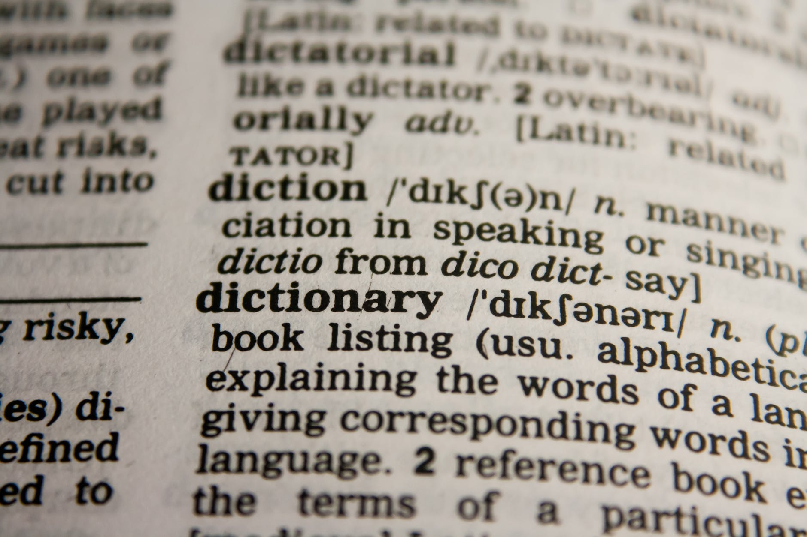

I'm sure I am not the only person who constantly thinks about the language they use, and the potentially negative impact that it might have on others.

> Intention may not equate to impact
>
>
>
> Darren Powell

I've included my own quote above, because often there is no harm or malicious intent in people's language when they speak to others. But often the phrase or words used can land with others and at best make them uncomfortable and at worst - harm.

The reason that I'm 'micro-blogging' this thought is down to a Radio Four Today programme interview with [Chris Packham](https://en.wikipedia.org/wiki/Chris_Packham) I heard this morning (09/06/2023). [Amol Rajan](https://en.wikipedia.org/wiki/Amol_Rajan) was speaking to a piece about the issues that [Weymouth residents seem to be having with "sea-weed"](https://www.thetimes.co.uk/article/weymouth-residents-kick-up-a-stink-over-rotting-seaweed-p7nktc8r9). As soon as Chris was introduced in the interview, he took Amol to task with using the word "seaweed". Chris pointed out that immediately there is a negative association with the phrase, and the correct term is "sea algae". He also went on to point out some of the massive benefits that algae provide for the planet - more oxygen production that the entire planet's rainforests, and also carbon sequestration. He also said that people need to get over themselves at the inconvenience of "mother nature", and applauded Weymouth's council for their approach on this matter - the tides will literally turn and wash this back out to sea.

But this little conversation brought me back to my own internal debates about the language I use and how we can phrase things better.

For example - in the team I work with you will often find me using the term "guys".

> Thanks guys, we will catch-up tomorrow.

I hate myself for doing it, and I openly apologised and invited challenge from the individuals involved. They aren't all guys either! 
Nobody took exception, and I was relieved that I hadn't offended the great people I work with - but I could have. **_"Intention may not equate to impact"._**

In a more positive example, one pointed out to me by my "tutor" during my training years, always try and focus on the positive aspects of the issue in hand. Can we look at it through a "lens of positive perspective". So whenever we would have an item out of stock in the pharmacy, he always told me to present the issue with a positive context.

> Hello Mrs Smith, just to confirm with you that we have eight of the nine items on your prescriptions at the moment, and we will get remaining item in for later today/tomorrow/next week.

Ok, so it's the glass half full scenario - but quite often we don't approach conversations in that manner, and so we can quietly easily get a negative impact.

So I will sign off now "people/folks/peeps?" (I need to work on this). 
Here's hoping all your impacts match your intentions.
