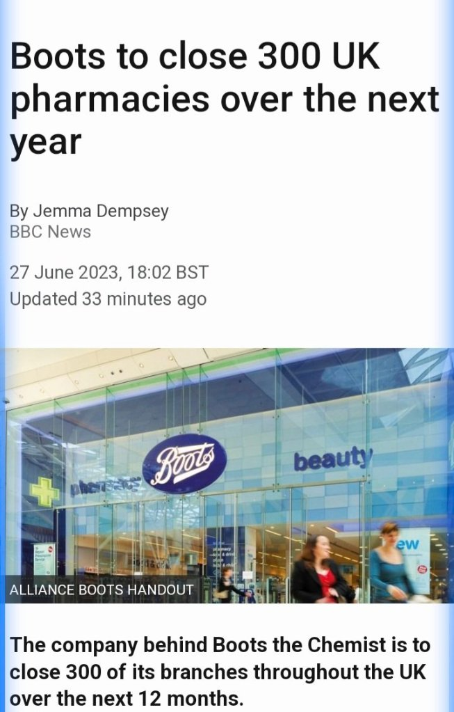
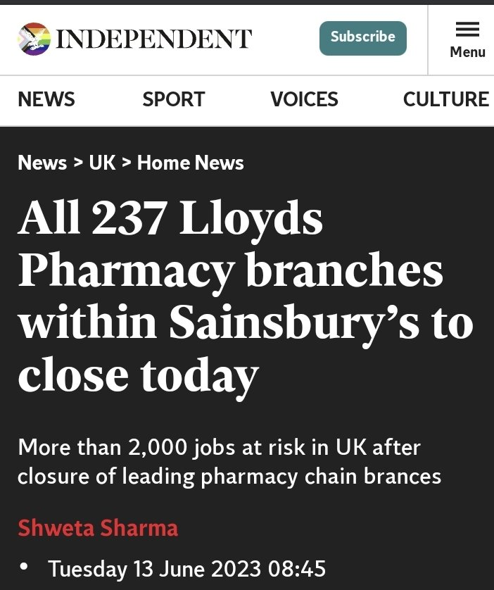
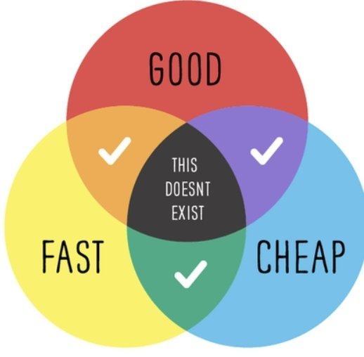

This evening I've heard the breaking news that Boots are planning a series of closures over the next year. It is reported in several national newspapers that they plan to close 300 branches in a business "consolidation".

https://www.bbc.co.uk/news/business-66032556.amp

This is on the back of the closures of Lloyds pharmacies situated in the Sainsbury's footprint - all 237 branches.

https://www.independent.co.uk/news/uk/home-news/lloyds-pharmacy-sainsbury-shut-down-b2356317.html

You could say the outlook for pharmacy in the community isn't promising. The government played an absolute blinder when they negotiated the static (in terms of payment) contract with Community Pharmacy England (nee PSNC) around four years ago. They really have squeezed the sector despite its ever increasing efficiency in dispensing medicines to the public. But IMHO they've gone too far, and I think this is signalled by the big corperations pulling out of the sector - they can't withstand (and their shareholders won't tolerate) diminishing returns on the big investment that pharmacy needs to operate. There are easier ways for them to increase their ROI.

But these headlines don't speak about those smaller family concerns and single handed independent pharmacies who probably can't afford to 'cut lose and run' and I'm sure because they are community focused - they don't want to leave their patients stranded. But what about the now, unmet, demand from 500 (in 2023) closed pharmacies? Will patients expect to be able to move seamlessly to the remaining pharmacies, without a glitch?

Pharmacy teams are already dealing with huge demands, and often an under resourced workforce - add more to that, and will the workforce be able to cope? Or is this the start of a domino effect destabilising the network further?

Whilst there is this unatural attrition of pharmacy mumbers, the government also made a policy decision to permit 100 hr pharmacy contracts to reduce their opening times (with certain caveats) to 75 hrs. Why? The cynical part of me thinks, to stop this part of the network from collapsing too. It effectively provides a free of charge, or subsidised extended hours provision of pharmaceutical services, and to lose this would be catastrophic. I already see GP Out Of Hours services highlighting the lack of service on bank holidays and late evenings.

Slowly the impact of these closures and changes will dawn upon the patient populations. Increased waiting times, worsening stock availability, reduced open access to the healthcare professional on the high street. Some will undoubtedly switch to the online providers, and will like the Amazon approach to getting their medicines (until there's an issue or a postal strike). Others will want the service they used to have , but frankly can't be delivered on the funding available.

It reminds me of the "pick two out of the three" scenario. How do you want your pharmacy services to be?

