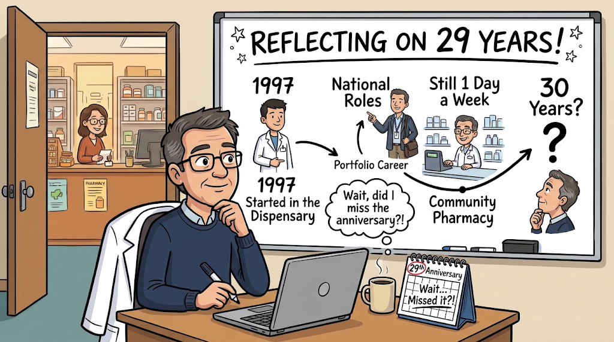

I missed it. At the start of this month, an anniversary passed me by without my realising: 29 years with the same community pharmacy company.

My first thought was not celebration. It was a question. Will I make it to 30?

That length of service says something about me. But more importantly, it says something about the company.

**It started with a diploma**

I joined because the company put me through my clinical diploma at the University of Bradford. They invested in me before I had given them anything back. I felt supported, and that feeling was the start of a long journey of future roles and growth.

Early in my career, I was backed to develop and take on roles well outside the traditional community pharmacy path. That support did not just shape my career. It shaped how I think about what an employer owes its people.

**It has not been perfect**

My career has run alongside significant cuts to government investment in pharmacy and health, and the company's fortunes are tied to those decisions. That has meant tightened belts, resisting staff cuts, and sometimes pressure on benefits.

But imperfect is not the same as indifferent. A company squeezed by forces outside its control can still be a place where people feel backed.

**Perfection is too high a barrier**

If we wait for a perfect workplace before we commit to one, we will wait forever. No such place exists.

What I found instead was something more achievable and, I think, more valuable:

- Investment in me before I had proved anything
- Trust to try roles that did not fit the usual mould
- Support that continued, even when money was tight

That was good enough to stay. Good enough to enjoy the journey, not just reach the destination.

**A call to everyone**

Whatever your role, you help shape the place someone works. You might lead a team, manage a rota, or simply be the colleague who makes a hard week easier.

So I will leave you with two questions:

- Who invested in you before you had given anything back?
- Who could you do that for this week?

I do not yet know whether I will reach 30 years. But I know exactly why I reached 29.
